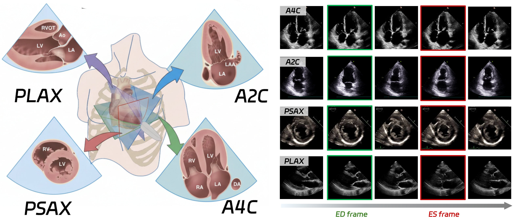

<div align="center">
  
</div>

<h1 align="center" style="font-size: 36px; margin-bottom: 4px">FrameONE: ONE for Echocardiographic Keyframe Detection</h1>

<div align="center">


<a href="https://github.com/szuboy/FrameONE">
  
</a>
[](https://github.com/szuboy/FrameONE/stargazers) 
<br/>  

</div>

We present FrameONE, a unified end-to-end framework for multi-view echocardiographic keyframe detection. FrameONE introduces a Hierarchical Motion Modeling strategy that learns cardiac dynamics at both intra-view and inter-view levels. Within each view, a multi-task learning scheme reduces appearance bias and encourages motion-focused representations; across views, a general motion learning module disentangles view-agnostic cardiac dynamics from view-specific motion patterns.
FrameONE enables accurate detection of end-systole (ES) and end-diastole (ED) frames across A4C, A2C, PSAX, and PLAX views using a single unified model. Evaluated on 25,872 echocardiography videos spanning four standard views, FrameONE achieves state-of-the-art keyframe detection performance with strong cross-view generalization.


## Paper

<b>FrameONE: Hierarchical Motion Modeling for Universal Multi-View Echocardiographic Keyframe Detection</b> <br/>
[Rusi Chen](https://scholar.google.com/citations?user=EdfJGdwAAAAJ&hl=en), [Yuhao Huang](https://scholar.google.com/citations?user=mciKo6MAAAAJ&hl=en), [Hongyuan Zhang](), Chao Tian, Shunan Ji, Yuhan Zhang, [Dong Ni](https://scholar.google.com/citations?user=J27J2VUAAAAJ&hl=en) <br/>
Shenzhen University, CAIR-HKISI, Nanjing Medical University <br/>
MICCAI 2026 <br/>
<a href='https://drive.google.com/file/d/1GOI4WlMgG7l8x81nLEOoYNf_o2Usdcg1/view?usp=sharing'></a> <a href='https://drive.google.com/file/d/1iDbnr6uDqZ06ePdwDJmntj9CmB4TcSHv/view?usp=sharing'></a>
<a href='https://papers.miccai.org/miccai-2026/0393-Paper3530.html'></a>


## Setup

Use Python 3.10 or later and install PyTorch for your CPU or CUDA environment.

```bash
pip install -r requirements.txt
```

## Data

Set the paths in `config.yaml`. Configuration paths are relative to the YAML file.
Video paths in annotation files can be absolute or relative to `dataset.data_root`.
Provide `Train.json`, `Val.json`, and `Test.json` containing lists of records:

```json
[
  {
    "patient_id": "example_001",
    "file_path": "example_001.avi",
    "view": "A4C",
    "keyframe": {"ES": 20, "ED": 40},
    "dataset_name": "example"
  }
]
```

`dataset.label_index_base` defaults to `0`; set it to `1` for one-based annotations.
Mixed sources can use `label_index_base_by_dataset` or `label_index_base_by_path`
in the dataset configuration, or `labels_zero_based: true` on a record.
The view order in the configuration must remain `[A4C, A2C, PSAX, PLAX]`.

Optional full-cycle annotation files use the same record format with ES and ED
lists, for example `"keyframe": {"ES": [20, 60], "ED": [40, 80]}`.
Configure their filenames in `train.val_full_label_files` and
`train.test_full_label_files` to compute FP/FN, RMSE, and R² in addition to MAE.
Missing optional files are skipped. Clear these mappings to disable this evaluation.

## Run

```bash
python train.py --config config.yaml
```

Set `train.pretrained_model` to a checkpoint to resume training. To evaluate it:

```bash
python train.py --config config.yaml --test
```

The training loop uses AdamW with a base learning rate of 0.005 and cosine decay
with five warmup epochs. It writes CSV history,
JSON metrics, the last checkpoint, and checkpoints selected by loss, MAE, weighted
MAE/FP, and combined MAE/FP ranks. Evaluation uses overlapping windows, Gaussian
smoothing, and a 0.5 threshold for ES minima and ED maxima. Evaluation batch size is one.

## Targets and losses

The paper specifies ES=0 and ED=1 without defining intermediate phase targets.
This implementation linearly interpolates between labeled frames and extends the
nearest label outside the annotated interval. It preserves every labeled endpoint.
Gaussian responses are used only for regression weights: sum unit-height kernels
with sigma=2 at every ES/ED index, then add 1. The weighting is independent of the
phase target and has no additional scale factor.

The loss is weighted Smooth L1 plus 0.1 times motion reconstruction MSE,
0.01 times cross-subspace orthogonality, and 0.1 times view cross-entropy.
The orthogonality term is the squared Frobenius norm of the global/local basis
cross-product, averaged over samples using each sample's view-specific local basis.
There is no amplitude loss. Reconstruction retains its elementwise mean reduction;
the coefficient L1 term from the paper is not included.

## Files

- `model.py`: ResNet18, motion bases, and Transformer.
- `trainer.py`: target curves, losses, and sliding-window inference.
- `dataset.py`: video loading and training augmentation.
- `evaluation.py`: MAE and optional full-cycle metrics.
- `train.py`: training and evaluation entry point.

This release uses torchvision's standard ResNet18 with a 256-dimensional final
linear layer, initialized without pretrained weights. Other backbones, model variants, contrastive learning, inactive loss
options, feature plots, and experiment-specific paths and exclusions were removed.
The original custom-CNN checkpoints are incompatible with this architecture and
score definition. Train a new model before evaluating this version.
The data loader was included from the parent project's imported dataset module,
with its unused optical-flow and EchoPrime paths removed.
Gradient accumulation includes the final partial group of batches.
Dataset files and pretrained weights are not bundled.

Run the CPU checks with `python -m unittest discover -s tests -v`.
